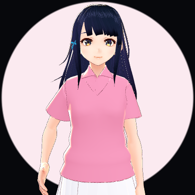
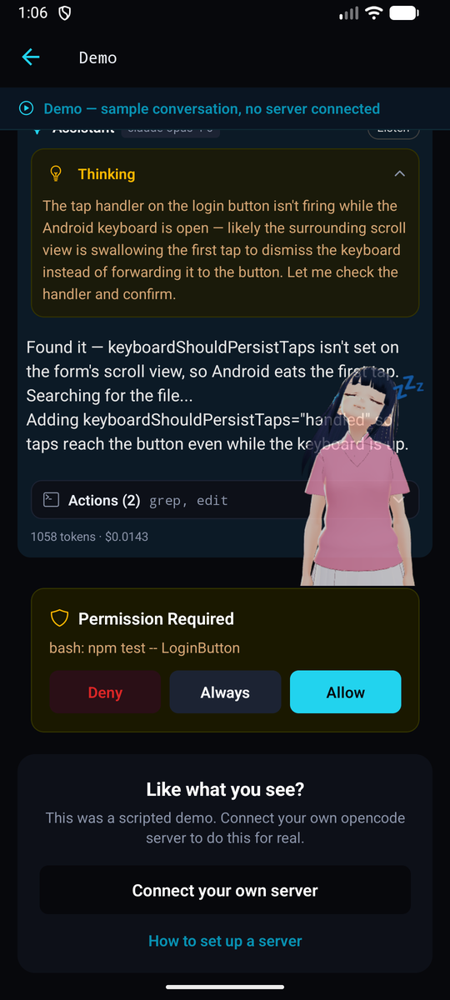
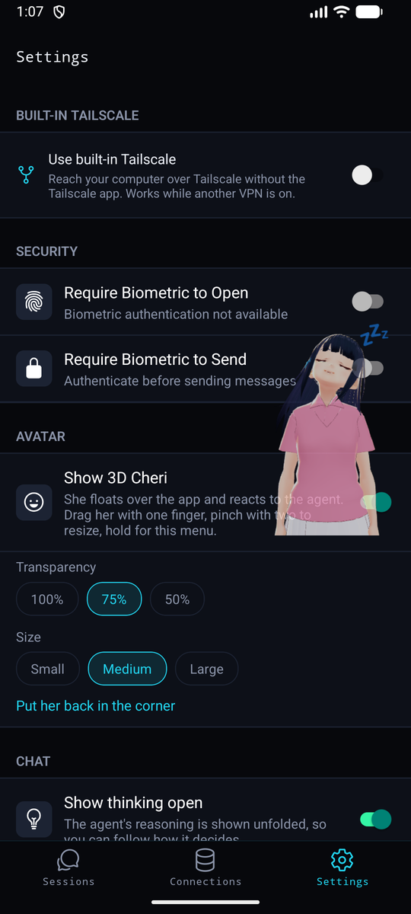
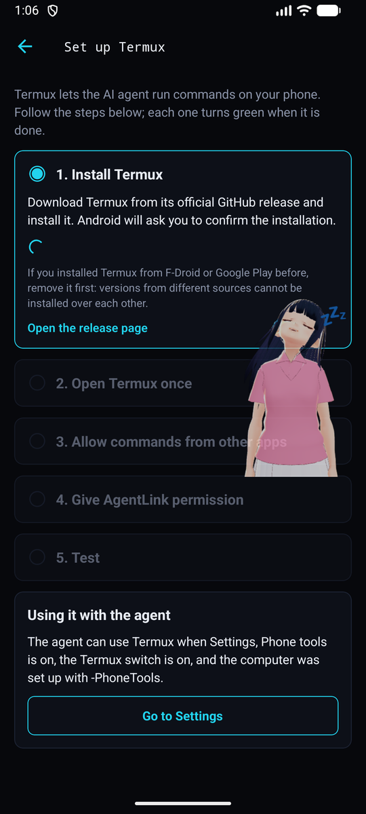

<p align="center">
  
</p>

<h1 align="center">AgentLink</h1>
<p align="center"><sub>formerly OpenCode Mobile · works with opencode, Claude Code, Codex, Gemini CLI and other agents</sub></p>

<p align="center">
  <b>Your coding agent, in your pocket.</b><br/>
  A dark, minimal, neon-edged client where you can see the agent think, work and write.
</p>

<p align="center">
  <b>English</b> ·
  <a href="docs/readme/README.ru.md">Русский</a> ·
  <a href="docs/readme/README.zh-Hans.md">中文</a> ·
  <a href="docs/readme/README.es.md">Español</a> ·
  <a href="docs/readme/README.de.md">Deutsch</a> ·
  <a href="docs/readme/README.fr.md">Français</a> ·
  <a href="docs/readme/README.pt.md">Português</a> ·
  <a href="docs/readme/README.ja.md">日本語</a> ·
  <a href="docs/readme/README.ko.md">한국어</a> ·
  <a href="docs/readme/README.uk.md">Українська</a> ·
  <a href="docs/readme/README.tr.md">Türkçe</a>
</p>

<p align="center">
  
  
  
  
</p>

<p align="center">
  
  
  
  
  
  
  
</p>

<p align="center"><sub>Screenshots are from earlier versions, when the mascot was still the robot RIG.</sub></p>

A native Android client for coding agents that run on **your own computer**: [opencode](https://github.com/sst/opencode)
out of the box, and through the open [Agent Client Protocol](https://agentclientprotocol.com) also Claude Code, Codex,
Gemini CLI and more (table below). It talks only to the computer **you** run, over your own network. Nothing goes
through a relay or a hosted service.

> Independent community client; not affiliated with the opencode team or any agent vendor. Android package id: `cc.agentlabs.opencode`.

## Supported agents

| Agent | How |
|---|---|
| opencode | Native: sessions, models, MCP connectors, terminal, files |
| Claude Code, Codex, Gemini CLI, Cursor, Kimi Code, Mistral Vibe, Augment (Auggie), Factory Droid, Kiro, Goose, Qwen Code, GitHub Copilot CLI | Through ACP: **Sessions → Other agents**. The agent runs on the computer with its own login and tools; the phone shows its answers, plan, tool calls and file changes and asks before it acts |

The *Other agents* screen also lists supported agents that are not installed on the computer yet. Up to four agents run
at once, and a running agent keeps working when you close the screen. Some features (model picker, server-side session
list) are still opencode-only.

## Highlights

**See what the agent is doing.** A live activity bar names the phase (*Agent is thinking*, *Using bash*,
*Writing the answer*), pulses while it works and keeps a timer. While a reasoning model thinks, its block
breathes, previews the last lines of the thought and collapses to *Thought for 0:12* when done.

**Clear chat.** The agent's thinking is shown open by default and its commands and edits fold into one *Actions* line;
both are switches in *Settings → Chat*. *Agent speaks my language* asks the agent to think and reply in the app's language.

**Know what is wrong.** A status chip walks the chain phone → computer → server → agent, says which link is down,
explains why and offers the fix. Error messages say what happened.

**Pair with your computer in one scan.** Run one script on the computer, point the phone camera at the QR
code, confirm, done (no camera? type the 6-digit code). The server stays on `127.0.0.1` and is published only inside
your Tailscale network. At home the app connects straight over the home network, no VPN needed, and the phone has
a built-in Tailscale client, so the Tailscale app is optional.

**Pick the brain, local or cloud.** The model picker has *All / Local / Cloud* chips with counts. Models
served from your own machine (llama.cpp, Ollama, LM Studio, anything on localhost, LAN or Tailscale) are
marked *on your computer*, so switching from a hosted model to your local one is a single tap.

**Connectors on tap.** Settings lists the server's MCP connectors (mail, browser, phone, ...) with on/off
switches. No config editing on the computer.

**Listen and dictate in your language.** Read any reply aloud; voice input follows the app or device
language instead of being English-only.

**Start the server from your phone.** If the server on your computer is off, the app shows a **Start it** button.

**Answer the agent from anywhere.** When the agent asks for approval, a banner with Deny / Always / Allow appears on
any screen, and the notification has the same buttons.

**Talk to it.** Tap the headset: speak, hear the reply, and it listens again.

**Share to OpenCode.** Send text, links, images and small files from any app into a session. Search and pin sessions.

**Give the agent a phone (optional).** Ready-made tools let an agent look at and tap the screen, read the
battery, send notifications, take photos and more, always behind per-action approval. See
[agent phone tools](#agent-phone-tools).

Also: streaming chat, inline diffs, tool-call approval, image attachments, several servers, biometric lock,
credentials in the Android Keystore, dark mode.

**Terminal and files.** Open a real shell on the computer (xterm in a WebView, with Esc / Tab / Ctrl and
arrow keys) or browse the project and read files, straight from the session header.

## Meet Cheri

<p align="center"></p>

**Cheri** is the AgentLink mascot. Her ear lights and face show what the agent is doing (thinking, working, writing,
done, offline). She waves, winks, yawns, naps and plays little skits, and reacts when you tap her.

- **3D Cheri** floats over the whole app. She types while the agent works, holds her chin under a light bulb while it
  thinks, celebrates when it is done and sleeps when the computer is off. Drag her anywhere, pinch to resize, a quick tap
  goes through her to the button underneath, hold to pick her up and hold a little longer for her menu (hide, transparency, size).
- Turn her on or off in **Settings → Avatar**. Without the 3D model you get the animated 2D Cheri.
- The earlier robot mascot **RIG** is still selectable in Settings (including the offline runner game, **RIG RUN**).

Design: dark only, blue-black with neon cyan and magenta accents, monospace in the chrome. Tokens live in
[`src/theme/cyber.ts`](src/theme/cyber.ts).

**Credit.** The 3D model is "Sendagaya Shino" by the VRoid project (pixiv), an official VRoid Studio sample model. Its
license allows redistribution, modification and commercial use; see
[`web/cheri3d/model/LICENSE.md`](web/cheri3d/model/LICENSE.md).

## Install in three steps (about two minutes)

Full guide with troubleshooting: **[docs/INSTALL.md](docs/INSTALL.md)**. It is also available in
[Русский](docs/INSTALL.ru.md), [中文](docs/INSTALL.zh-Hans.md), [Español](docs/INSTALL.es.md), [Deutsch](docs/INSTALL.de.md),
[Français](docs/INSTALL.fr.md), [Português](docs/INSTALL.pt.md), [日本語](docs/INSTALL.ja.md), [한국어](docs/INSTALL.ko.md),
[Українська](docs/INSTALL.uk.md) and [Türkçe](docs/INSTALL.tr.md).

**1. Computer: paste one command.** Open PowerShell (Windows) and paste:

```powershell
& ([scriptblock]::Create((irm https://raw.githubusercontent.com/jainikdroid-bit/AgentLink/main/tools/opencode-connect.ps1)))
```

macOS / Linux, in Terminal:

```sh
curl -fsSL https://raw.githubusercontent.com/jainikdroid-bit/AgentLink/main/tools/opencode-connect.sh | sh
```

It installs what is missing (Node.js, opencode, Tailscale), asks you to sign in to Tailscale once, starts the server and
opens a page with two QR codes.

**2. Phone: install.** Scan the first QR code (or open [Releases](https://github.com/jainikdroid-bit/AgentLink/releases/latest)),
download the APK and open it. Install Tailscale on the phone too and sign in with the same account.

**3. Phone: pair.** Open the app, tap **Scan QR to pair**, point it at the second QR code, tap **Connect**.

Re-running the command is safe (it repairs instead of duplicating). No Tailscale wanted? `-Mode lan` (same Wi-Fi) or
`-Mode tunnel` (free Cloudflare tunnel, see the guide for the trade-off).

### Let an AI agent do it

Tell your AI agent (Claude Code, opencode, Codex, ...): *"Set up AgentLink for me following
https://github.com/jainikdroid-bit/AgentLink/blob/main/docs/AI-SETUP.md"*. The runbook is written for agents: JSON output,
exit codes, exact commands, safety rules. You only click **Yes** on a Windows prompt, sign in to Tailscale once and tap **Connect** on the phone.

## Agent phone tools

Built in: run the installer with `-PhoneTools` and switch the tools on in the app. The agent gets `phone_*` tools,
including `phone_termux_run` (a bash command in Termux on the phone, approved on the phone each time), and is told about
them (`phone-tools.md` for opencode; ACP agents get the phone MCP server on `session/new`).

Termux needs no manual setup: **Settings → Phone tools → Set up Termux** downloads Termux from its official GitHub
release, checks its SHA-256, installs it and walks you through allowing external apps, the permission and a test command.

Other options run on the desktop side and plug into opencode as MCP servers.

| Tool | What it gives the agent |
|---|---|
| [`@mobilenext/mobile-mcp`](https://www.npmjs.com/package/@mobilenext/mobile-mcp) | See the screen, tap, type, launch apps (adb, wireless debugging) |
| [`tools/termux-mcp/phone_mcp.py`](tools/termux-mcp/phone_mcp.py) | Battery, location, notifications, camera, SMS, clipboard, speech, ... via Termux:API, run over SSH |

Keep them behind a dedicated agent and approval, for example:

```jsonc
"permission": { "phone_*": "ask", "mobile_*": "ask" },
"tools": { "phone_*": false, "mobile_*": false },
"agent": { "phone": { "mode": "primary", "tools": { "phone_*": true, "mobile_*": true } } }
```

**Notifications.** The app itself notifies about approval requests (with Allow / Deny buttons) while it holds
its connection; Android may put it to sleep after a few minutes. A notification you build yourself can open a session and
send a reply to it with a link such as `opencode://session/<id>?replyHex=<hex-encoded text>`.

## Build

Requirements: Node 22+, JDK 17, Android SDK.

```bash
npm ci
npm run typecheck && npm test      # unit tests
node scripts/build-cheri3d.mjs     # bundles the 3D Cheri (three, three-vrm, esbuild are devDependencies)
cd android && ./gradlew assembleRelease
```

The APKs land in `android/app/build/outputs/apk/release/`: one per CPU architecture (`arm64-v8a` fits almost
every modern phone, `armeabi-v7a` old 32-bit ones, `x86_64` emulators) and a larger universal one. A release build is signed with the debug key unless
you provide your own signing config, so uninstall other builds of the app before installing it.

## Privacy

No analytics, no crash reporting, no accounts. The app talks only to the servers you add. The one other
request is an optional once-a-day check of this project's GitHub releases to tell you about updates.
Credentials live in the Android Keystore.

## License

MIT. See [LICENSE](LICENSE). Based on the MIT-licensed OpenCode Mobile project.
