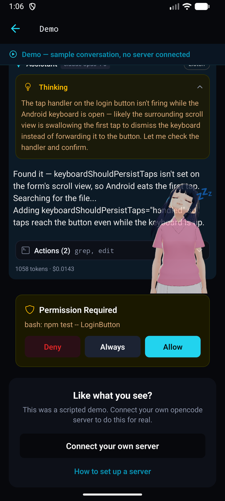
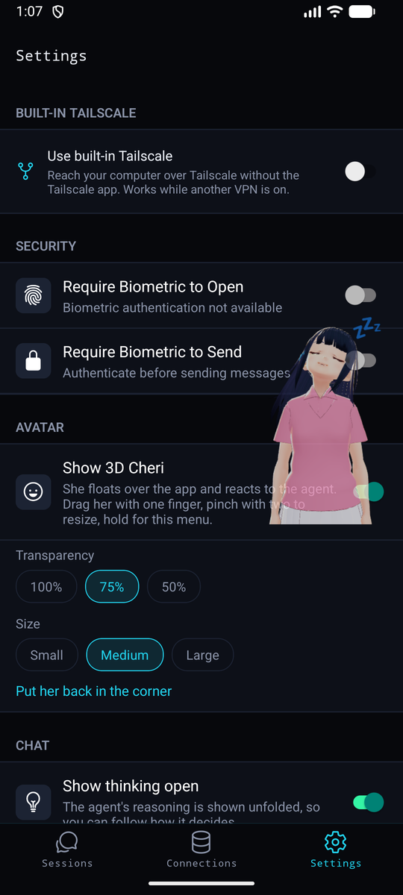
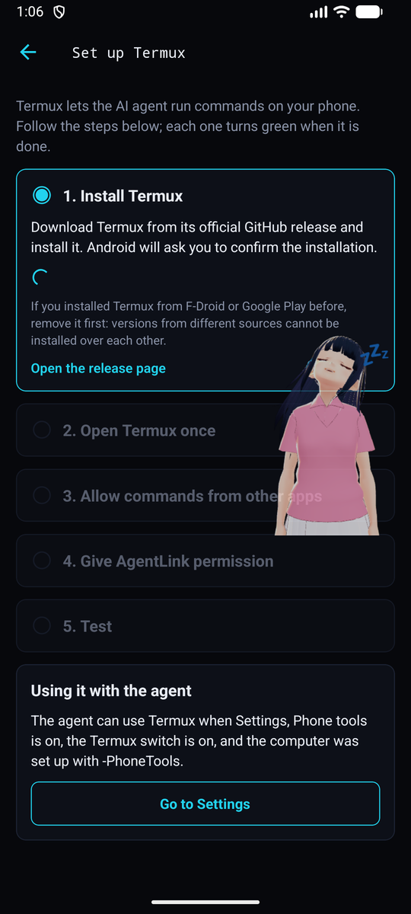

<p align="center">
  
</p>

<h1 align="center">AgentLink</h1>
<p align="center"><sub>OpenCode Mobile · opencode, Claude Code, Codex, Gemini CLI …</sub></p>

<p align="center">
  <b>Ваш кодинг-агент в кармане.</b><br/>
  Тёмный минималистичный клиент с неоновыми акцентами, где видно, как агент думает, работает и пишет.
</p>

<p align="center">
  <a href="../../README.md">English</a> ·
  <b>Русский</b> ·
  <a href="README.zh-Hans.md">中文</a> ·
  <a href="README.es.md">Español</a> ·
  <a href="README.de.md">Deutsch</a> ·
  <a href="README.fr.md">Français</a> ·
  <a href="README.pt.md">Português</a> ·
  <a href="README.ja.md">日本語</a> ·
  <a href="README.ko.md">한국어</a> ·
  <a href="README.uk.md">Українська</a> ·
  <a href="README.tr.md">Türkçe</a>
</p>

<p align="center">
  
  
  
  
  
  
  
</p>

Нативный клиент Android для [opencode](https://github.com/sst/opencode), а также Claude Code, Codex, Gemini CLI и других агентов через ACP. Он общается только с сервером, который запускаете **вы**, по вашей собственной сети. Никаких ретрансляторов и облачных сервисов.

> Независимый клиент сообщества; не связан с командой opencode.

## Возможности

**Видно, что делает агент.** Живая полоса активности называет этап («Агент думает», «Использует bash», «Пишет ответ») и ведёт таймер; блок рассуждений сворачивается в «Думал 0:12».

**Сопряжение одним сканированием.** Запустите на компьютере один скрипт, наведите камеру на QR-код, подтвердите. Сервер остаётся на `127.0.0.1` и публикуется только внутри вашей сети Tailscale.

**Модель на выбор: локальная или облачная.** Фильтр «Все / Локальные / Облачные»; модели с вашего компьютера помечены, переключение — одно касание.

**Запуск сервера с телефона.** Если сервер на компьютере выключен, приложение покажет кнопку «Запустить».

**Отвечайте агенту откуда угодно.** Просьба агента о разрешении появляется баннером на любом экране; в уведомлении те же кнопки.

**Голосовой диалог.** Нажмите на гарнитуру: говорите, слушайте ответ, и приложение снова слушает.

**«Поделиться» в OpenCode, поиск и закрепление сессий.**

**Терминал, файлы, MCP-коннекторы,** диффы, вложения-изображения, несколько серверов, биометрическая блокировка, ключи в Android Keystore.

## Быстрый старт — выберите способ подключения

[Скачать APK для Android](https://github.com/jainikdroid-bit/AgentLink/releases/latest) · [Подробная инструкция](../INSTALL.ru.md)

| Где будете пользоваться | Что выбрать |
|---|---|
| Дома и из других сетей | Tailscale — один аккаунт на двух устройствах |
| Только в одной доверенной Wi-Fi сети | LAN — без аккаунта Tailscale |

**1. Подготовьте компьютер.** Откройте PowerShell или Терминал и выполните команду.

<details open>
<summary>Windows — PowerShell</summary>

```powershell
& ([scriptblock]::Create((irm https://raw.githubusercontent.com/jainikdroid-bit/AgentLink/main/tools/opencode-connect.ps1)))
```

Для домашней сети добавьте в конце `-Mode lan`.

</details>

<details>
<summary>Linux / macOS — Терминал</summary>

```sh
curl -fsSL https://raw.githubusercontent.com/jainikdroid-bit/AgentLink/main/tools/opencode-connect.sh | sh
```

Для домашней сети замените последний `sh` на `sh -s -- --mode lan`.

</details>

**2. Установите приложение** из [Releases](https://github.com/jainikdroid-bit/AgentLink/releases/latest). В режиме Tailscale войдите в один аккаунт на компьютере и телефоне. В режиме LAN вход не нужен.

**3. Подключитесь.** Сканируйте QR подключения (не QR скачивания APK), введите 6 цифр или вставьте ссылку сопряжения. Проверьте имя компьютера и подтвердите. Пароль создаётся автоматически.

<details>
<summary>Если что-то не получается</summary>

- **401:** сервер не принял учётные данные. Повторите установку и сопряжение. Имя пользователя установщика — `opencode`.
- **Компьютер не найден:** проверьте сеть, питание и адрес рядом с кодом.
- **Модель не отвечает:** вход в AgentLink и вход в OpenCode/Codex/Claude Code — разные вещи. Настройте агента на компьютере.
- Не публикуйте ссылки сопряжения, пароли и токены.

</details>

### В разработке: версия 0.26.6

В [ветке обновления](https://github.com/jainikdroid-bit/AgentLink/tree/fix/agentlink-auth-guide) добавлены пошаговый мастер, раскрывающиеся пояснения, исправления проверки пароля и индикации ошибок. Cheri по-прежнему перемещается пальцем и масштабируется. Новый APK ещё не опубликован; доступные сборки — в Releases.

### Пусть всё сделает ИИ-агент

Скажите агенту (Claude Code, opencode, Codex, ...): *«Настрой для меня AgentLink по инструкции https://github.com/jainikdroid-bit/AgentLink/blob/main/docs/AI-SETUP.md»*.

Дизайн, инструменты телефона для агента и сборка из исходников описаны в [английском README](../../README.md).

## Приватность

Без аналитики, без отчётов о сбоях, без аккаунтов. Приложение общается только с добавленными вами серверами. Единственный другой запрос — необязательная раз в сутки проверка релизов этого проекта на GitHub. Учётные данные хранятся в Android Keystore.

## Лицензия

MIT. См. [LICENSE](../../LICENSE).
